# AMR 번호판 재관측 · 읽을 수 있는 자리로 다시 이동하기

두산 부트캠프 프로젝트에서 맡았던 **번호판 재인식 이동 로직**을 Isaac Sim에서 다시 구현했다. 출발점은 상위 시스템이 AMR을 차량 근처까지 보냈지만, 비스듬한 시야 때문에 번호판을 읽지 못한 순간이다. 상위 시스템은 대상 차량의 대략적인 위치를 알려 준다. **어디에 다시 서고 어느 쪽을 바라봐야 하는지**는 AMR이 카메라와 LiDAR로 결정한다.

최종 실험에서는 앞뒤에 같은 번호판을 단 세단 한 대를 두고 여섯 방향에서 출발했다. 정차한 AMR이 서로 다른 사진 세 장에서 `123가4567`을 연속으로 읽은 결과는 **유효 36회 중 22회**, 센서 중단을 포함하면 **전체 37회 중 22회**였다. [최종 실험 보고서](docs/create3-sedan-height.md) · [0.75 m 카메라 주행 영상](docs/media/create3-sedan-height/height075-all-4x.mp4) · [1.05 m 카메라 주행 영상](docs/media/create3-sedan-height/height105-all-4x.mp4)

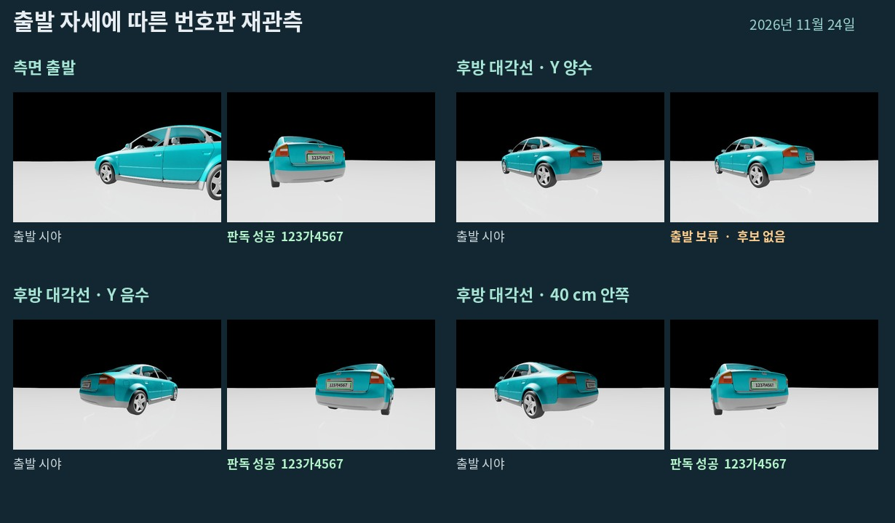

위 그림의 왼쪽 위는 옆면에서 출발해 모서리를 거쳐 판독에 성공한 사례다. 오른쪽 위는 후방 대각선에서 목표가 이동 한도를 넘어 출발을 보류한 사례다. [네 자세의 주행 영상](docs/media/create3-recovery-demo.mp4) · [각 회차의 목표 좌표와 판독 점수](docs/media/create3-trials.json)

## 개발 과정

### 11월 11–12일 · LiDAR로 차량 옆면을 찾다

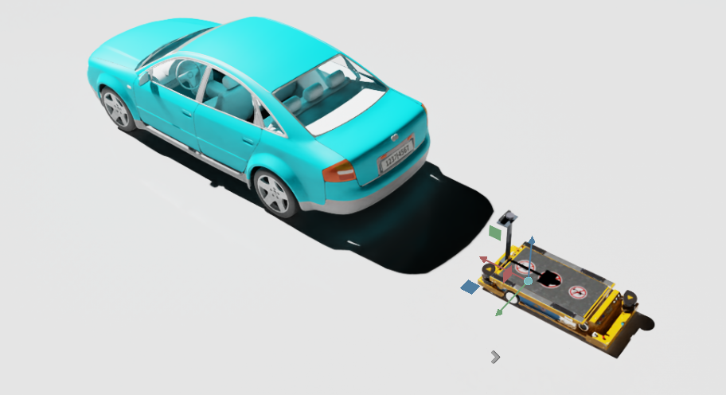

**초기 장비와 대상 차량.** 11월 12일 Isaac Sim에서 촬영한 장면이다. 왼쪽은 뒷범퍼에 시험 번호판을 단 세단, 오른쪽은 앞쪽에 카메라와 관측용 LiDAR를 세운 iw.hub이다.

첫 실험에서는 iw.hub 로봇을 차량과 평행하게 세웠다. 2D LiDAR 스캔에서 유효한 점을 모아 **RANSAC**으로 한 직선에 가까운 점들을 고르고, **PCA**로 그 점들 전체를 대표하는 직선을 다시 맞췄다. RViz에서 원본 점과 추정 직선을 겹쳐 보고, 로봇을 양쪽으로 약 10°씩 돌려도 차체 방향을 따라가는지 확인했다. 같은 자리에서도 범퍼의 둥근 부분이 얼마나 보이는지에 따라 선분 끝점이 흔들렸다. 끝점 평균화 등을 비교한 뒤, 실제 출발 목표는 서로 다른 스캔에서 일관된 후보가 반복될 때 확정하기로 했다. [측면 추정과 RViz](ros2_ws/src/amr_reobservation/docs/stage2_vehicle_side.md) · [회전 비교](ros2_ws/src/amr_reobservation/docs/stage4_rotation_check.md) · [연속 관측 검증](ros2_ws/src/amr_reobservation/docs/stage4_candidate_stability.md)

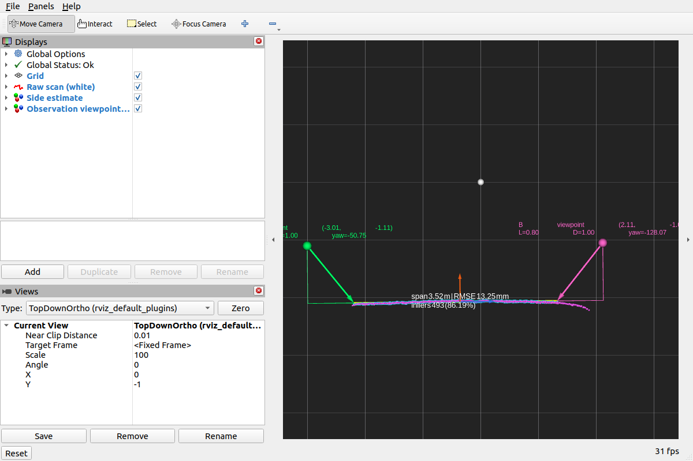

**RViz에서 후보 위치와 시선 읽기.** 흰 점은 LiDAR의 위치이고, 아래쪽으로 길게 이어진 점들이 측정한 차량 옆면이다. 초록색과 분홍색 **원은 센서를 놓아 볼 두 자리**, 각 **화살표의 끝은 그 자리에서 바라볼 지점**이다. 이 단계에서는 옆면 양 끝에서 길이 방향으로 0.80 m, 옆면에서 수직으로 1.00 m 떨어진 자리를 표시해 계산을 검증했다. [평행 배치의 후보 계산과 실측값](ros2_ws/src/amr_reobservation/docs/stage4_parallel_candidates.md)

### 11월 13–18일 · 대각선에서 옆문과 범퍼를 구별하다

실제 재인식 상황에 가깝게 AMR을 차량 뒤 대각선에 세웠다. 제자리에서 차량을 화면 중앙에 넣어도 번호판은 계속 비스듬했고, LiDAR에 보이는 선분 길이도 시야에 따라 달라졌다. 그래서 카메라 영상으로 차량의 **길이 방향 축**을 추정하는 CFV 모델을 적용했다. CFV는 차가 길게 놓인 방향을 알려 주고, LiDAR는 그 방향을 따라 놓인 옆면과 가로놓인 범퍼가 실제로 어디에 있는지 알려 준다. 관측한 범퍼를 더 정면에서 볼 위치로 이동하자 양쪽 후방 대각선에서 번호판 상자를 다시 검출했다. [CFV 시험과 좌표 변환](ros2_ws/src/amr_reobservation/docs/cfv_orientation_test.md)

모델 선택에는 같은 원본 사진 네 장을 사용했다. CFV의 차량 축 평균 오차는 5.15°였다. OpenPifPaf Apollo-24는 네 장 모두 방향 계산에 필요한 특징점 수를 확보하지 못했고, PartImageNet++ 기반 부위 분할 모델은 대각선 사진 두 장에서 후면과 측면을 함께 분리하기 어려웠다. 이 비교로 주행에 연결할 모델을 CFV로 정했다. 세 모델의 비교 자료는 실험 브랜치 `experiment/vehicle-orientation-comparison`의 `vehicle_model_comparison_summary.md`에 있다.

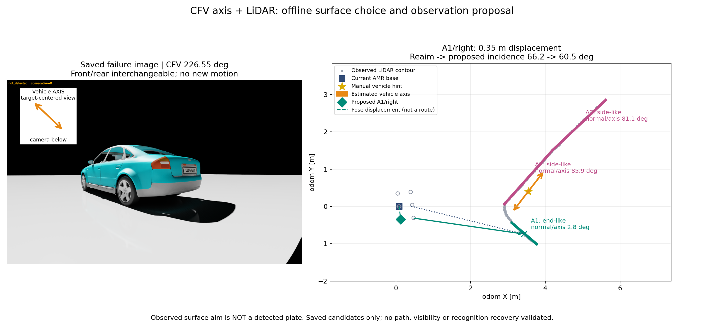

**번호판이 검출되지 않은 사진으로 다음 자리를 계산한 예.** 왼쪽 사진에서 CFV가 추정한 주황색 양방향 화살표는 차량의 길이축이다. 오른쪽 평면도에서 그 축과 LiDAR 점을 맞춰 보니 분홍색 선분은 옆면, 청록색 선분은 범퍼 후보였다. 남색 사각형이 현재 AMR 위치, 청록색 마름모가 약 0.35 m 떨어진 촬영 후보, 청록색 ×가 카메라를 돌려 바라볼 점이다. 이 그림은 11월 13일 저장한 관측으로 계산한 결과다.

### 11월 19–20일 · 번호판 검출에서 실제 판독까지 검증하다

번호판에 상자가 생겨도 한글 **‘가’를 ‘7’로** 읽는 경우가 있었다. 이동 후 저장한 동일한 번호판 다섯 장으로 한국어 PaddleOCR 입력을 비교했다. 원본 그대로는 4/5장, 520×110으로 크기와 비율을 맞추면 5/5장이 정답과 일치했다. 네 모서리를 이용한 원근 보정도 5/5장이어서 통합 실행에는 단순 크기 조정을 적용했다. 이후 이동 전과 도착 후에 같은 기준으로 원본을 수집하고 판독해, 이동이 실제로 글자를 읽는 데 도움이 됐는지 비교할 수 있게 했다. [OCR 입력 비교 실험](ros2_ws/src/amr_reobservation/docs/plate_rectification_validation.md) · [이동 전후 평가 절차](ros2_ws/src/amr_reobservation/docs/plate_recovery_evaluation.md)

주행을 반복하자 로봇이 정지해 있어도 일부 각도의 LiDAR 점이 사라져 필요한 차체 면을 확보하지 못하는 회차가 나왔다. 출발 전에는 새 사진과 스캔을 기다리고, 관측이 회복되면 그때 얻은 자료로 후보를 다시 확인하도록 했다. 끝내 근거가 모이지 않으면 이동을 보류하고 원인을 기록한다. [재관측 실행 순서와 종료 조건](ros2_ws/src/amr_reobservation/docs/single_candidate_ocr_recovery.md)

### 11월 21일 · Create 3로 바꾸고 옆면 출발을 추가하다

| Create 3와 센서 지지대 · 실험 USD 근접 렌더링 | 세단 옆에 선 Create 3 · 11월 21일 Isaac Sim 캡처 |
|:---:|:---:|
| 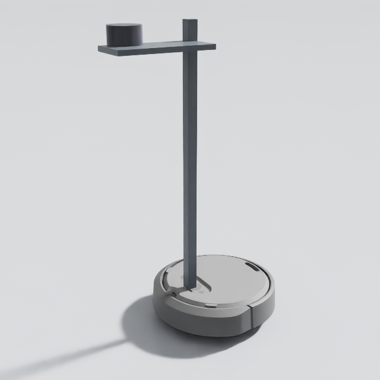 | 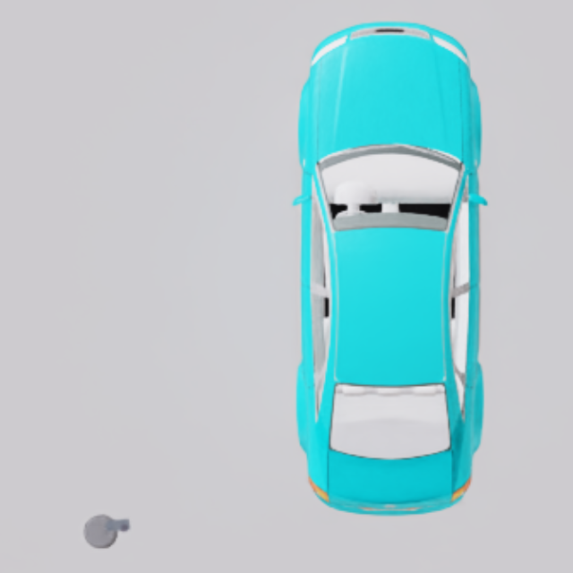 |

반복 주행 시간을 줄이고 실제로 사용하는 센서를 명확히 하려고 iw.hub에서 **Create 3**로 실험 장면을 옮겼다. 기존 장면은 관측·전방·후방 LiDAR를 경로 간격 확인에 사용했다. Create 3에서는 전방 Hawk RGB 카메라 한 대와 RPLidar S2E 한 대를 쓰고, 같은 LiDAR로 차체 윤곽과 남은 경로의 간격을 확인한다. 속도 명령 상한은 직진 0.42 m/s, 회전 1.35 rad/s로 설정했다. 시작 자세를 바꿔도 같은 차량을 가리키도록 장면의 차량 월드 좌표를 그 회차의 로봇 주행 좌표계(`odom`)로 변환했다. [Create 3 장면](amr_create3_camera_fail.usd) · [차량 힌트 변환](ros2_ws/src/amr_reobservation/docs/fixed_vehicle_hint.md)

- **옆문만 보이면 갈 곳이 없었다.** 관측한 옆면을 따라 가까운 끝점을 지난 뒤 정지하고, 그 모서리를 다시 바라보는 첫 이동을 추가했다. 첫 정지에서도 번호가 안 읽히면 새로 보이는 범퍼를 이용해 두 번째 자리를 계산한다. 한 시험에서는 모서리를 1.00 m 지나도 첫 정지 사진 8장 모두 미검출이었고, 두 번째 정지에서 세 장 연속 판독했다. [모서리 후보 계산](tools/corner_probe.py)
- **모서리에서 왔던 길로 되돌아가는 경우가 있었다.** 범퍼를 거의 옆에서 보면 현재 카메라 위치만으로는 범퍼의 바깥 방향을 고르기 어렵다. 차량 중심 힌트에서 관측한 범퍼로 향하는 방향을 차량 길이축에 투영해, 해당 범퍼를 지나 차체 밖으로 나가는 쪽에 촬영 후보를 놓았다. [범퍼 바깥 방향과 후보 계산](tools/cfv_view_trial.py)
- **사람에게 선명한 번호판도 기존 검출기가 놓쳤다.** 같은 차량을 열 위치에서 촬영해 비교했다. 점수 0.50 이상이고 기준 상자와의 겹침 비율이 0.50 이상인 사진은 기존 검출기가 4/10장, 한국 번호판용 RTMDet가 10/10장이었다. 검출기를 교체하고, 정차 판독에서는 수집한 원본과 사진 번호를 검출기에 직접 전달했다. 이로써 다른 시각의 상자가 저장 사진에 붙는 문제를 피했다. [원본 단위 검출·OCR](ros2_ws/src/amr_reobservation/docs/single_candidate_ocr_recovery.md)

### 11월 23일 · 도착 직전의 왕복 회전과 LiDAR 중단을 구분하다

목표에 거의 도착한 로봇이 차량을 향해 돌다가 다시 주행 방향으로 돌아서는 현상이 있었다. 위치 오차가 2 cm 경계를 오갈 때마다 제어기가 위치 맞추기를 재개한 것이 원인이었다. 이제 **목표 XY의 2 cm 안에 한 번 들어오면 위치 도착을 기억**하고, 그 구간에서는 카메라 방향만 맞춘다.

비슷하게 보이는 정지도 기록을 확인하면 원인이 달랐다. 실제로 스캔 점이 사라진 경우가 있었고, 점은 들어왔지만 보이는 면이 달라져 차량 힌트의 2.00 m 탐색 반경 밖으로 나간 경우도 있었다. 새 목표를 찾을 때는 2.00 m를 쓰고, 확정된 목표에 접근할 때는 2.10 m까지 허용했다. 최종 촬영 위치에서 제자리 회전 중에는 반경 이탈 하나만으로 멈추지 않도록 했다. ROS bag과 Isaac 내부의 원본·누적 스캔을 함께 기록해 어느 단계에서 점이 줄었는지도 비교할 수 있다. [실제 궤적과 정지 판정](ros2_ws/src/amr_reobservation/docs/create3_motion_guide.md)

### 11월 24–25일 · 출발 방향, 차체 외관, 카메라 높이를 비교하다

첫 촬영 목표 한도 1.75 m로는 네 배치 중 세 곳에서 판독했다. 후방 대각선 A에서는 1.83 m 떨어진 후보도 한도를 넘어 출발하지 못했다. 한도를 1.90 m로 늘린 뒤 후면 번호판 장면에서 여섯 자세를 두 번씩 시험해 8/12회 성공했고, 앞쪽 네 번은 출발 전에 멈췄다. 이후 전방에서도 판독까지 평가할 수 있도록 앞 범퍼에 같은 번호판을 달았다. [1.75 m 실험 영상](docs/media/create3-recovery-demo.mp4) · [1.90 m 실험 보고서](docs/create3-190-validation.md) · [12회 주행 영상](docs/media/create3-190/six-starts.mp4)

전방에서 CFV 방향 오차가 커지는 조건도 살펴봤다. 별도 A7 장면에서 원본 재질과 좌전방 자세를 고정하고 카메라 각도를 유지한 채 높이를 0.75 m에서 1.05 m로 올리자, 정지 영상의 평균 차량 축 오차가 41.5°에서 26.1°로 줄었다. 이 결과를 바탕으로 **기존 세단**에서 두 높이로 실제 주행과 판독까지 반복했다. A7 정지 영상 비교는 `experiment/audi-a7-cfv-comparison` 브랜치의 `docs/a7-cfv-comparison.md`에, 세단 주행 결과는 아래 표에 정리했다. [최종 실험 조건과 시작 좌표](docs/create3-sedan-height.md)

## AMR은 어디에 서고 무엇을 바라보나

한 번의 요청에서 AMR은 최대 두 번 이동한다. 처음부터 범퍼가 보이는 뒤 대각선에서는 촬영 위치로 바로 갈 수 있다. 반대로 옆문만 보이면 첫 이동의 목적은 **다음 스캔에 범퍼가 들어오는 시야를 확보하는 것**이다.

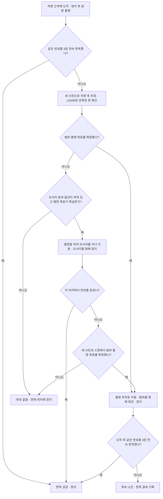

**① 어떤 면이 범퍼인가.** 정지 영상 세 장에서 CFV가 추정한 차량 길이축이 서로 5° 이내로 일치하는지 확인한다. 같은 시각대의 LiDAR 스캔에서는 차량 힌트 근처의 점들을 선분으로 나눈다. 옆문에 수직인 방향은 차의 옆을 향하고, 범퍼에 수직인 방향은 차의 길이 방향을 향한다. 그래서 **선분에 수직인 방향과 차량 길이축 사이의 작은 각**이 30° 이하면 끝면(앞·뒤 범퍼), 60° 이상이면 옆면 후보로 분류한다. 그 사이는 판단을 보류한다. [CFV 축과 LiDAR 면 분류](tools/cfv_axis_geometry.py)

**② 범퍼가 보이면 어디에 서나.** 같은 끝면이 최신 스캔 세 번에서 확인되면 그 구간의 가운데에 가장 가까운 실제 LiDAR 점을 **렌즈가 바라볼 조준점**으로 쓴다. 번호판이 아직 안 보일 때 범퍼 가운데를 대신 조준하는 것이다. 조준점에서 범퍼 바깥 방향을 기준으로 좌·우 45°, 거리 2.00 m인 두 곳에 렌즈를 놓아 본다. 렌즈가 조준점을 향하도록 카메라의 장착 위치까지 반영해 **로봇이 설 XY와 최종 회전각**을 구한다. 관측각이 10° 이상 개선되고 이동 거리·회전·경로 간격 조건을 통과한 후보 중 덜 이동하는 쪽을 선택한다. [촬영 위치 계산](tools/cfv_view_trial.py)

**③ 옆면만 보이면 어떻게 돌아가나.** 모서리 탐색 옵션을 켜면 옆면 양 끝에서 AMR까지의 거리를 비교한다. 가까운 끝점이 분명하면 옆면과 평행하게, 현재 자리에서 그 끝점까지의 투영 거리와 설정한 추가 거리만큼 이동한 뒤 **관측한 모서리**를 바라본다. 여기서 다시 판독하고, 실패하면 이전 후보를 버리고 새 사진과 스캔으로 ①·②를 수행한다. 이 거리 비교는 옆면만 보이는 분기에서 사용한다. [모서리 이동과 재관측](ros2_ws/src/amr_reobservation/docs/create3_motion_guide.md#side)

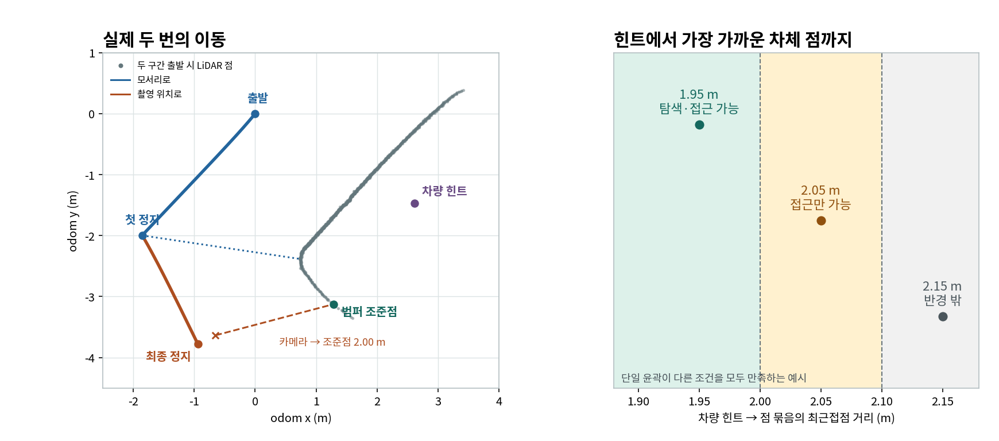

11월 23일의 실제 성공 주행에서는 출발 사진 8장과 첫 정지 사진 8장 모두 번호판이 미검출이었다. 그래도 첫 이동 **2.74 m** 후 약 **0.79 m**의 끝면이 세 번 관측됐다. 그 면으로 계산한 두 번째 자리까지 **2.02 m** 이동한 뒤, 첫 세 장에서 같은 번호를 읽었다. [실측 궤적과 세 장의 검출·OCR 점수](ros2_ws/src/amr_reobservation/docs/create3_motion_guide.md)

**④ 이동 중 무엇을 확인하나.** 각 구간의 목표는 출발할 때 고정한다. 주행 중에는 현재 위치에서 목표까지의 선분과 최신 LiDAR 점 사이의 최소 간격을 확인하고, 1.20 m 미만이면 중단한다. 스캔·오도메트리·좌표 변환의 시각도 확인한다. 위치에 도착하면 제자리에서 렌즈를 미리 정한 조준점으로 돌리고, 정지를 확인한 뒤 촬영한다. [주행·정지 조건](ros2_ws/src/amr_reobservation/docs/create3_motion_guide.md#drive)

**⑤ 무엇을 성공으로 보나.** 정차 시 4초 동안 최대 8장의 원본을 수집한다. C++ 검출기가 사진마다 번호판 상자(검출 점수 0.50 이상)를 찾고, 그 안의 픽셀과 사진 번호를 Python PaddleOCR로 보낸다. C++ 판정 노드는 서로 다른 원본에서 **같은 한국 번호판 형식의 문자열을 세 장 연속** 읽으면 세 번째 장에서 성공을 확정한다. 세 장 모두 OCR 점수 0.80 이상, 인접 사진 간격 1.5초 이하, 상자 겹침 비율(IoU) 0.30 이상이어야 한다. 실행 중에는 정답을 알려 주지 않고, 실험 결과를 집계할 때 실제 번호와 대조한다. [판독 노드와 서비스](ros2_ws/src/amr_reobservation/docs/single_candidate_ocr_recovery.md)

구현에서 **C++ ROS 2 노드**는 LiDAR 윤곽·조준점 계산, 번호판 상자 검출, 연속 OCR 판정을 맡는다. **Python**은 CFV와 PaddleOCR 추론, 촬영 위치 선택, 이동·재관측 순서와 속도 명령을 맡는다. 속도 명령은 별도 감시기를 거쳐 Isaac Sim의 차동 구동기로 전달된다. [통합 제어기](tools/run_recovery_trial.py) · [속도 명령 감시기](tools/recovery_command_guard.py)

## 최종 세단 실험 결과

같은 세단의 앞·뒤에 같은 번호판을 달고, 출발 자세·렌즈 방향·LiDAR 높이(0.80 m)·주행 설정을 고정했다. **카메라 높이만** 0.75 m와 1.05 m로 바꾸고, 여섯 시작 자세에서 유효 세 회씩 실행했다. 모서리를 지나 더 이동하는 거리는 1.50 m였다.

**한 회차에서 Create 3가 본 장면.** 아래는 1.05 m 카메라로 좌측면에서 출발한 첫 회차다. 각 사진은 해당 위치에 정지한 뒤 저장한 첫 프레임이다.

| 출발 · 옆문만 보임 | 첫 정지 · 모서리에서 뒤를 봄 | 두 번째 정지 · 범퍼를 더 정면에서 봄 |
|:---:|:---:|:---:|
| 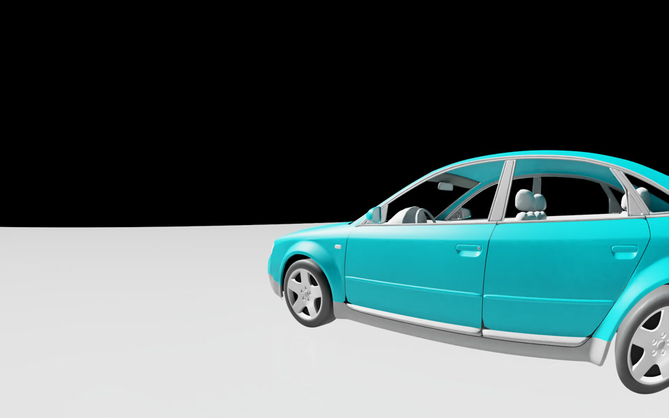 | 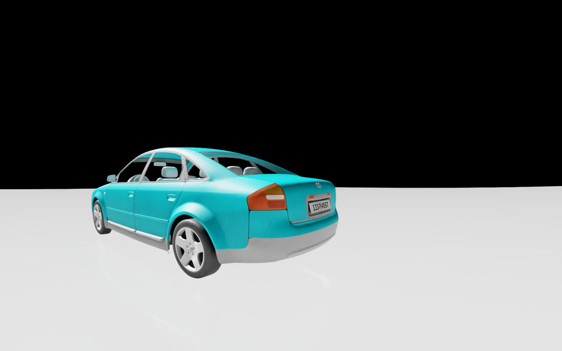 | 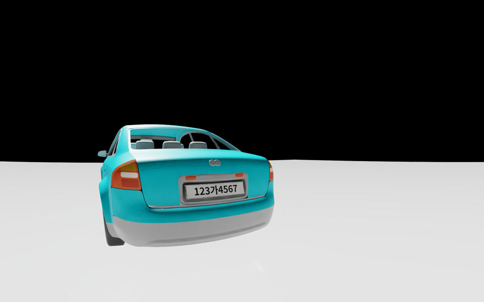 |
| 번호판 미검출 | 번호판이 보이지만 연속 판독 조건 미충족 | 첫 세 장에서 **`123가4567`** 일치 |

| 차량 기준 AMR 출발 위치 | 0.75 m 성공/유효 | 1.05 m 성공/유효 |
|---|---:|---:|
| 좌전방 대각선 | 0/3 | 0/3 |
| 우전방 대각선 | 0/3 | 3/3 |
| 좌측면 | 3/3 | 3/3 |
| 우측면 | 1/3 | 0/3 |
| 좌후방 대각선 | 3/3 | 3/3 |
| 우후방 대각선 | 3/3 | 3/3 |
| **합계** | **10/18 (55.6%)** | **12/18 (66.7%)** |

**우전방**에서는 카메라를 높이자 출발 전 CFV 축 오차가 평균 39.8°에서 11.2°로 줄고 판독도 0/3에서 3/3으로 늘었다. **좌전방**에서는 오차가 66.3°에서 23.3°로 줄었지만 판독은 여전히 0/3이었다. 높은 카메라로 세 번 모두 모서리까지 갔어도, 그곳에서 다음 촬영 목표를 확정하지 못했다. 같은 차량에서도 출발 방향에 따라 높이 변경의 효과가 달랐다. [영상별 시각과 6방향 해석](docs/create3-sedan-height.md) · [사진별 CFV 오차](docs/media/create3-sedan-height/initial_direction_angles.csv)

유효 결과는 **22/36 (61.1%)**, 전체 시도 기준은 **22/37 (59.5%)**다. 0.75 m 우측면에서 같은 정지 자세의 LiDAR 점이 338 → 68 → 342 → 71개로 바뀌며 차량 윤곽을 잃은 한 회만 사전 기준에 따라 제외했다. 같은 자리에서 다시 실행해 좌표계 기울기로 중단된 회차는 유효 실패에 포함했다. 이 수치는 한 시뮬레이션 차량의 여섯 출발 자세에 대한 반복 결과다. [37회 판정·OCR 점수·영상 시각](docs/media/create3-sedan-height/attempts.csv) · [제외한 회차의 스캔](docs/media/create3-sedan-height/h075_side_right_r2_scans.json)

## 실행하기

Ubuntu 22.04, ROS 2 Humble, Isaac Sim 5.1.0, C++17 환경에서 실행했다. 장면이 참조하는 차량 파일 `sedan_car.usd`, 번호판 검출 모델 `assets/models/plate_kr_rtmdet_v4.onnx`, CFV 가중치와 PaddleOCR 환경은 로컬에 준비한다. 다른 PC에서는 `--config`로 CFV·OCR 환경 경로를, `--model-path`로 검출 모델을 지정할 수 있다. [ROS 패키지 빌드 안내](ros2_ws/src/amr_reobservation/README.md) · [모델 및 실행 설정](ros2_ws/src/amr_reobservation/docs/single_candidate_ocr_recovery.md)

**처음 한 번 빌드하고 설정을 확인한다.** 마지막 줄은 주행 전 설정 확인용이다.

```bash
cd ~/peter_pjt
bash tools/setup_onnxruntime.sh
source /opt/ros/humble/setup.bash
(cd ros2_ws && colcon build --symlink-install --packages-select amr_reobservation)
./run_recovery_test.sh
```

**최종 조건으로 한 회 실행한다.** Isaac Sim에서 아래 두 높이 중 하나의 장면을 열고, Stop 상태에서 `/create3`의 위치와 yaw를 설정한 후 Play를 누른다. Isaac Sim과 터미널의 ROS 도메인을 맞추고 저장소 루트에서 실행한다. [0.75 m 장면](experiments/create3-sedan-height/sedan_camera075.usda) · [1.05 m 장면](experiments/create3-sedan-height/sedan_camera105.usda) · [재현용 월드 좌표와 yaw](docs/create3-sedan-height.md)

```bash
./run_recovery_test.sh --execute --corner-probe-once 1.50
```

`--corner-probe-once`의 거리를 생략하면 0.35 m, 옵션 전체를 생략하면 끝면을 확인해 직접 촬영 위치로 가는 분기만 사용한다. 이전 iw.hub 조건은 `amr_camera_fail.usd`와 `--robot iw_hub --speed fast`로 실행한다.

### 실행 기록 읽기

터미널 마지막 줄에 실행 폴더가 표시된다. 기본 위치는 `local_artifacts/recovery_runs/<실행 ID>/`다. 각 단계에 도달하면 해당 기록이 생긴다.

| 확인할 내용 | 실행 폴더 안의 파일 |
|---|---|
| 최종 상태·판독 문자열·중단 사유 | `result.json`의 `status`, `text`, `error` |
| 첫 목표·모서리에서 다시 고른 목표·실제 도착 시각 | `controller/selection.json`, `controller/after_corner/selection.json`, `controller/events.jsonl` |
| 이동 전·모서리·최종 위치의 사진과 판독 | `controller/` 아래 `before_capture/`, `corner_capture/`, `after_capture/` 및 대응하는 `*_ocr/report.json` |
| LiDAR·오도메트리·시계·좌표 변환 | `sensors/` ROS 2 bag |

### 통합 주행 중 LiDAR 누락 기록

ROS bag과 Isaac 내부 센서 출력을 함께 확인하려면 **Window → Script Editor**에서 아래 두 줄을 한 번 실행한다. 프로젝트를 다른 경로에 두었다면 그 경로를 지정한다.

```python
import runpy
runpy.run_path('/home/peter-msi/peter_pjt/tools/watch_recovery_lidar_in_gui.py')
```

같은 앱에서는 Stop → Play 후에도 기록기를 사용할 수 있다. 주행 중 점 수가 급감하거나 내부 완성 스캔이 멈추면 `lidar_internal/`에 감소 전 최대 3초와 이후 5초의 내부 데이터를 남긴다. `result.json`의 `lidar_internal.status`로 기록 상태를 확인한다. `--no-lidar-internals`를 붙이면 ROS bag만으로 시험할 수 있다. [감지 기준과 중단 사유별 확인 방법](ros2_ws/src/amr_reobservation/docs/create3_motion_guide.md#diagnosis)
