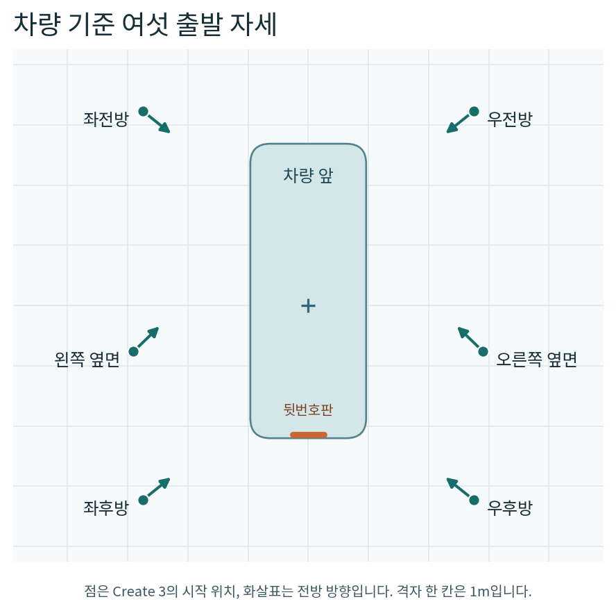

# Create 3 번호판 재관측 실험 · 첫 촬영 목표 1.90m

2026년 11월 24일, 같은 세단 주위 여섯 위치에서 두 번씩 실행해 **12회 중 8회** 정답 `123가4567`을 판독했다. 각 회차는 독립된 Stop → Play에서 시작했다. 최종 성공은 서로 다른 정지 영상 세 장에서 같은 번호가 연속으로 확인된 경우다.

[12회 주행 영상 · 챕터가 있는 MP4](media/create3-190/six-starts.mp4) · [회차별 목표 좌표, 센서 기록 수와 OCR 점수 (JSON)](media/create3-190/results.json)

## 차량의 어느 쪽에서 출발했나

세단 앞은 월드 +X, 차량의 왼쪽은 +Y다. 좌후방은 기존 후방 대각선 A와 같은 자리다. 반대편은 차량 힌트 (3.9532, 0.0828)m를 기준으로 대칭 배치했다. 옆면 두 자리는 모서리 선택을 관찰하려고 차량 힌트보다 약 0.76m 뒤에 뒀다. 각 회차의 실제 시작 자세는 ROS bag의 첫 `world → base_link`로 확인했다.

| 배치 | 월드 X / Y (m) | yaw | 1회차 | 2회차 | 정답 판독 |
|---|---:|---:|---|---|---:|
| 왼쪽 옆면 | 3.190 / 2.986 | -46.0° | 이동 후 성공 | 이동 후 성공 | 2/2 |
| 오른쪽 옆면 | 3.190 / -2.820 | +46.0° | 이동 후 성공 | 이동 후 성공 | 2/2 |
| 좌후방 대각선 | 0.725 / 2.831 | -51.3° | 이동 후 성공 | 이동 후 성공 | 2/2 |
| 우후방 대각선 | 0.725 / -2.665 | +51.3° | 이동 후 성공 | 이동 후 성공 | 2/2 |
| 좌전방 대각선 | 7.181 / 2.831 | -128.7° | 후보 없음 | 후보 없음 | 0/2 |
| 우전방 대각선 | 7.181 / -2.665 | +128.7° | 차량 축 추정 불일치 | 차량 축 추정 불일치 | 0/2 |

## 회차별 기록

영상은 전방 카메라·LiDAR 윤곽·오도메트리를 촬영 시각에 맞춰 실시간 기준 4배속으로 재생한다. 마지막 화면에는 최종 판정과, 성공했을 때는 세 번째 판독에 사용한 번호판을 표시한다. 이동 거리는 각 구간에서 출발점과 목표 사이의 직선거리다.

| 영상 시작 | 배치 · 회차 | 결과 | 이동·판정 근거 | 실행 시간 |
|---:|---|---|---|---:|
| 0:00 | 왼쪽 옆면 · 1 | 이동 후 성공 | 모서리 2.73m → 촬영 위치 1.62m · OCR 0.996~0.997 | 158.2초 |
| 0:43 | 왼쪽 옆면 · 2 | 이동 후 성공 | 모서리 2.76m → 촬영 위치 1.93m · OCR 0.997~0.999 | 164.0초 |
| 1:29 | 오른쪽 옆면 · 1 | 이동 후 성공 | 모서리 2.78m → 촬영 위치 1.58m · OCR 0.997~0.998 | 156.7초 |
| 2:12 | 오른쪽 옆면 · 2 | 이동 후 성공 | 모서리 2.76m → 촬영 위치 1.46m · OCR 0.995~0.996 | 149.2초 |
| 2:54 | 좌후방 대각선 · 1 | 이동 후 성공 | 촬영 위치 1.83m · OCR 0.996~0.997 | 82.7초 |
| 3:19 | 좌후방 대각선 · 2 | 이동 후 성공 | 촬영 위치 1.84m · OCR 0.997~0.998 | 87.3초 |
| 3:45 | 우후방 대각선 · 1 | 이동 후 성공 | 촬영 위치 1.61m · OCR 0.998~0.999 | 79.2초 |
| 4:10 | 우후방 대각선 · 2 | 이동 후 성공 | 촬영 위치 1.61m · OCR 0.998~0.999 | 74.2초 |
| 4:33 | 좌전방 대각선 · 1 | 후보 없음 | 촬영 후보가 이동 한도를 초과 · 3.61m, 6.48m (한도 1.90m) · 모서리 미확정 | 45.8초 |
| 4:48 | 좌전방 대각선 · 2 | 후보 없음 | 촬영 후보가 이동 한도를 초과 · 3.61m, 6.48m (한도 1.90m) · 모서리 미확정 | 44.4초 |
| 5:04 | 우전방 대각선 · 1 | 차량 축 추정 불일치 | 정지 사진 3장의 차량 길이축 추정 차이 9.0° (허용 5°) | 26.5초 |
| 5:15 | 우전방 대각선 · 2 | 차량 축 추정 불일치 | 정지 사진 3장의 차량 길이축 추정 차이 7.1° (허용 5°) | 33.5초 |

## 한도를 늘린 효과

좌후방 A는 이전 1.75m 실험에서 마지막에 확인한 1.831m 목표가 제외됐다. 같은 시작 자세에서 새로 선택한 목표는 1.826m와 1.838m였다. 두 번 모두 한 번 이동한 뒤 같은 번호를 세 장 연속 읽었다. 이 배치에서는 목표 거리 한도를 15cm 늘린 효과를 직접 확인했다. [이전 실험 기록](media/create3-trials.json)

전방에서 완료한 네 회차는 모두 출발 전에 멈췄다. 좌전방에서는 마지막에 검토한 두 촬영 목표가 두 번 모두 약 3.61m와 6.48m 떨어져 있었고, 모서리 이동 조건도 충족하지 못했다. 우전방에서는 사진 세 장에서 추정한 차량 길이축이 각각 최대 9.0°와 7.1° 벌어져 허용치 5°를 넘었다. 네 회차 모두 이동 후 전방 OCR 단계까지 도달하지 않았다.

한 대의 차량과 고정된 여섯 자세에서 각 두 번 측정한 값이다. 이 횟수로 다른 차량이나 임의의 시작 위치에서의 성공률까지 추정하기는 어렵다.

## 실험 조건

- 같은 Create 3, 동일한 세단, 검출 모델과 OCR 기준을 사용했다. 차량의 실험용 번호판을 장착한 위치는 뒤 범퍼다. 앞쪽 배치에서 출발한 결과는 이 단일 장면의 결과이며, 앞 범퍼에도 같은 번호판을 장착한 조건은 별도 실험이 필요하다. [번호판 설치 코드](../tools/add_rear_plate.py)
- 처음부터 범퍼를 확인했을 때 촬영 목표 한도는 1.90m, 주행 중 허용 반경은 2.00m다. 옆면 탐색에서 모서리를 더 지나는 거리는 1.50m, 이때 목표 한도는 2.80m다. 모서리에 도착한 뒤 고르는 다음 촬영 목표는 그 자리에서 최대 2.30m다. [구간별 거리 한도](../ros2_ws/src/amr_reobservation/docs/create3_motion_guide.md)
- 좌전방 첫 배치는 추가로 한 번 실행 도중 시뮬레이터와 관리 프로세스가 종료됐다(종료 코드 143). 제어기에는 모서리 도착 후 카메라 입력 지연이 남았고 통합 최종 결과 파일은 생성되지 않았다. 이 미완주 영상과 bag은 원본 폴더의 `interrupted/front_left_r1/`에 보존했다. 표에는 같은 좌표에서 끝까지 기록한 두 회차를 실었다. 이후에는 두 회차씩 앱을 새로 열어 수집했다.
- 각 회차에서 `./run_recovery_test.sh --execute --corner-probe-once 1.50`을 실행했다. 성공 판정에는 OCR 신뢰도 0.80 이상, 촬영 간격 및 번호판 상자 겹침 조건을 함께 적용했다.
- 원본 카메라 프레임, 회차별 영상, ROS bag, 제어 로그는 `local_artifacts/create3_190_20261124_of3k0v0u/<회차 ID>/`에 있다. JSON에 실제 실행 순서, 측정 시작 자세, 각 구간의 이동, OCR 증거와 실행 코드 SHA-256을 담았다.
