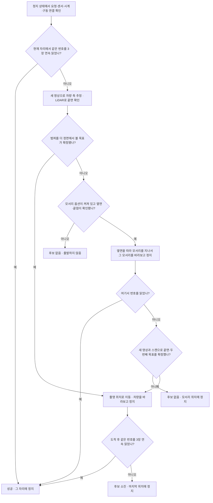
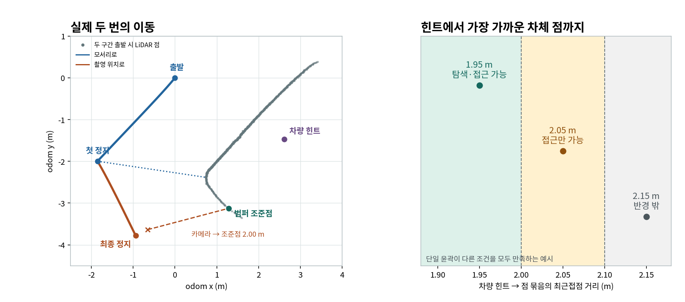

# Create 3는 어디로 갈지 어떻게 정하고, 왜 멈출까?

**2026년 11월 23일 기준** · 브랜치 `experiment/create3-single-lidar` · 동작 기준 커밋 `a4e121b`. 아래는 `amr_create3_camera_fail.usd`에서 `run_recovery_test.sh`로 실행하는 **정차한 차량 한 대의 번호판 재관측**이다.

AMR은 먼저 멈춰서 번호판을 읽는다. 읽히면 그 자리에서 끝난다. 읽히지 않으면 **카메라로 차량 길이 방향을 추정하고, LiDAR로 실제 차체가 어디에 보이는지 찾는다.** 범퍼를 볼 자리가 정해지면 그곳으로 한 번 이동한다. 옆면만 보이는 경우에는 옵션을 켰을 때 가까운 모서리를 먼저 지나고, 새 관측으로 한 번 더 이동할 수 있다. 한 번 정한 목표 위치·방향은 그 구간을 달리는 동안 고정한다.

**‘2.00m 기준’은 차량 위치 힌트에서 LiDAR 점 묶음의 가장 가까운 점까지 잰 거리다.** 예를 들어 센서가 차에서 3m 떨어져 있어도 옆문에서 돌아온 점이 차량 힌트에서 1m라면 그 묶음은 첫 거리 검사를 통과한다. 반대로 로봇에서 잘 보이는 범퍼여도 그 묶음의 모든 점이 힌트에서 2.05m 이상이면 새 목표를 만드는 데 쓸 수 없다.

[전체 흐름](#flow) · [LiDAR의 2.00m와 2.10m](#lidar) · [범퍼가 보일 때](#end-face) · [옆면만 보일 때](#side) · [주행과 정지](#drive) · [OCR](#ocr) · [실패 기록 읽기](#diagnosis)

## 1. 한 번 실행하면 무슨 일이 일어나나

그림의 ‘아니오’는 **센서와 판독 절차는 정상인데 번호나 후보를 얻지 못한 경우**다. 센서 시각, 좌표 변환, 주행 간격, 판독 서비스 등에 문제가 생겨 실행 자체를 신뢰할 수 없으면 각 단계에서 `aborted`로 빠질 수 있다. 한 실행에서 실제 목표 이동은 0~2회다. 자동 원점 복귀, 장애물 우회, 실패 후 무제한 재시도는 이 실행 경로에 없다. [실행 순서와 종료 분기](../../../../tools/recovery_ocr_policy.py) · [실제 제어기](../../../../tools/run_recovery_trial.py)

### 시작 자세와 명령에 따른 차이

| 실행 | 행동 |
|---|---|
| `~/peter_pjt/run_recovery_test.sh` | 설정·모델 경로를 확인하고 끝낸다. |
| `~/peter_pjt/run_recovery_test.sh --execute` | 끝면을 확인하면 촬영 위치로 간다. 끝면 후보가 없으면 출발하지 않는다. |
| `~/peter_pjt/run_recovery_test.sh --execute --corner-probe-once 1.50` | 끝면 후보를 먼저 찾고, 실패하면 옆면을 따라 모서리를 한 번 탐색할 수 있다. 1.50m는 **옆면 끝점을 지난 추가 거리**다. |
| `--execute --corner-probe-plus-30cm` | 비교 실험용 별도 경로다. 초기 판독 실패 후 모서리 후보를 바로 검사해 0.65m 지나간다. 첫 이동 후 OCR 결과로 끝난다. |

사용자가 Isaac Sim에서 실패 배치로 Play하면 셸 스크립트가 ROS 2 Humble 환경, Create 3, 장면 기반 모의 요청, 센서 bag 기록을 선택한다. ROS 도메인 기본값은 0이다. 상위 시스템이 최초로 차량까지 안내하는 과정은 실험의 시작 조건이다. [실행 진입점](../../../../run_recovery_test.sh) · [프로세스와 기록 관리](../../../../tools/run_plate_recovery.py)

### 어느 입력을 누가 쓰나

| 입력 또는 계산 | 주행에서 하는 일 |
|---|---|
| 차량 힌트와 처음 선 자세 | 장면의 `sedan_car` 원점과 AMR의 `world` 자세, 같은 스캔 시각의 `odom → base_link`를 이용해 차량 힌트를 이번 실행의 `odom` 좌표로 한 번 고정한다. `approach_pose`는 기본 설정상 출발 자세다. 재관측 목표는 이후 센서로 새로 계산한다. Play 전에 AMR을 옮겨도 차의 좌표를 다시 입력할 필요가 없다. |
| 앞쪽 RGB 카메라와 CFV | `/front_stereo_camera/left/image_raw`는 1920×1200이다. CFV는 정지 영상에서 **차량의 길이 방향 축**을 구한다. 번호판 박스와 글자는 각각 다른 모델이 처리한다. |
| 단일 LiDAR와 C++ 미리보기 노드 | `/observation_lidar/scan`에서 차체 점을 묶고 조준점을 만든다. 제어기는 같은 스캔의 유효점 전체로 경로 간격도 확인한다. 이전 iw.hub의 전·후방 별도 LiDAR는 Create 3 입력에 없다. |
| 시계·좌표 변환·오도메트리 | `/clock`은 시뮬레이션 시각, TF는 센서·차체·odom 사이의 위치 관계, `/chassis/odom`은 AMR의 실제 추정 위치·방향이다. 코드의 ‘현재 위치’와 ‘도착’은 odom 기준이다. |
| 목표 선택과 구동 | Python 통합 제어기가 CFV와 C++ 미리보기를 결합해 목표를 정하고 속도를 요청한다. 별도 명령 감시기가 `/cmd_vel`을 발행하고, Isaac 차동 구동기가 두 바퀴를 움직인다. |
| 번호판 판독 | C++ RTMDet가 박스를 찾고 Python PaddleOCR가 글자를 읽는다. 여러 사진을 종합해 성공을 확정하는 노드는 C++이다. |

차체 기준 카메라는 앞 약 31.5cm·왼쪽 8.3cm·높이 75cm, LiDAR는 앞 약 25.5cm·왼쪽 0.8cm·높이 80cm에 장착돼 있다. 그래서 ‘로봇 중심이 설 곳’, ‘렌즈가 있을 곳’, ‘렌즈가 바라볼 점’은 서로 다른 좌표다. 뷰포트 해상도와 ROS 카메라 렌더 해상도도 별도 설정이다. [Create 3 장면](../../../../amr_create3_camera_fail.usd) · [차량 힌트 설정](../config/camera_fail_test_hint.yaml) · [힌트 변환 코드](../scripts/mock_recovery_request.py)

## 2. LiDAR에 찍힌 점 중 무엇을 우리 차로 보나

왼쪽 실선은 odom에 기록된 **차체 중심의 궤적**이다. 파란 점선은 첫 정지 자리에서 관측한 모서리 쪽, 주황 파선은 계획한 카메라 위치(×)에서 범퍼 조준점으로 향한다. 회색 점은 두 구간 출발 시점의 LiDAR 실측점이다. 오른쪽은 같은 거리라도 **처음 찾는 중인지, 이미 정한 곳으로 가는 중인지**에 따라 결과가 달라지는 예시다.

1. **점을 지도 위에 놓는다.** 스캔 자체 거리 범위와 0.10~6.00m가 겹치는 구간에서 유한한 거리만 취한다. 측정 시각의 TF로 `odom`의 수평면에 옮긴다. 유효점이 하나도 없으면 `no_observed_points`다.
2. **이웃한 점을 묶는다.** LiDAR 빔 순서대로 보며 이웃한 점 사이가 18cm를 넘거나 중간에 빠진 빔이 2개를 넘으면 묶음을 나눈다. 전방위 스캔의 마지막과 처음도 실제로 이어지면 연결한다. 12점 미만 묶음은 차량 후보에서 제외한다.
3. **힌트에서 각 묶음까지 거리를 잰다.** 묶음 속에서 힌트와 가장 가까운 점까지의 거리를 쓴다. 이 값이 **2.00m 이하**인 묶음들 중 가장 가까운 것을 고른다. 가까운 두 묶음의 거리 차이가 **15cm 이하**면 어느 물체인지 애매해서 선택하지 않는다. 하나의 점만 반경 안에 있어도 그 점이 충분히 지지되는 묶음에 속하면 된다. 묶음 전체가 원 안에 들어가야 하는 조건은 없다.
4. **묶음에서 면을 찾는다.** 양 끝을 잇는 선분과 가장 크게 어긋나는 점이 6cm를 넘으면 그곳에서 구간을 나눠 반복한다. 남은 직선 구간 중 **12점 이상, 길이 45cm 이상**을 만족하는 것에서 긴 순으로 최대 세 구간을 남긴다. 따라서 짧은 범퍼가 RViz에 몇 점 보이더라도 조준점 후보가 하나도 없을 수 있다.
5. **각 면에서 바라볼 점을 고른다.** 해당 구간의 길이 방향으로 점들을 투영해 중간 위치에 가장 가까운 **실제 측정점**을 쓴다. 비교 기준은 AMR까지의 거리가 아니다. 이 점의 XY로 카메라를 조준하고 계산 높이는 카메라 높이로 둔다. 번호판의 실제 3차원 중심을 알아낸 것은 아니다.

**출발 뒤 10cm의 여유가 생기는 이유.** 같은 차도 바라보는 각도가 바뀌면 문짝 쪽 점은 사라지고 힌트에서 더 먼 범퍼만 남을 수 있다. 목표가 이미 고정된 Create 3의 모서리·촬영 위치 접근 중에는 최대 **2.10m**로 다시 계산한 상태를 쓴다. 이때 두 번째 물체까지 들어와 애매해지면 여전히 정지한다. 이 검사는 새 스캔마다 다시 계산한다. 이전 차체 점을 지도에 누적해 같은 차를 계속 추적하는 방식이나, 차 길이에 따라 반경을 자동 조정하는 기능은 현재 구현에 없다. 예를 들어 긴 차에서 힌트와 관측 가능한 범퍼 사이가 2.30m면, 그 범퍼만으로는 새 목표를 확정하기 어렵다. [윤곽 계산](../src/recovery_contour.cpp) · [탐색·접근 상태 발행](../src/recovery_preview_node.cpp) · [수치 설정](../config/recovery_preview.yaml)

| 혼동하기 쉬운 값 | 시작점 → 끝점 | 언제 쓰나 |
|---|---|---|
| **2.00 / 2.10m** | 차량 힌트 → 점 묶음의 최근접점 | 차량 찾기·새 목표 선택 / 이미 정한 목표에 접근 |
| **2.00m** | 목표 카메라 위치 → 범퍼 조준점 | 최종 촬영 위치 설계 |
| **2.00m 이상** | 관측한 윤곽의 첫 점 → 마지막 점 | 옆면만 보고 모서리로 가는 분기에서 필요한 옆면 윤곽의 길이(양 끝의 직선거리) |
| **1.20m 이상** | 남은 주행 선분 → 가장 가까운 유효 LiDAR 점 | 실제 주행 간격. 차량 힌트 위치와 별개 |
| **2cm 이하** | 차체 중심 → 고정한 목표 XY | 위치 도착을 기억하고 최종 회전으로 전환 |

## 3. 범퍼가 보이면 어디로 이동할까?

**CFV가 알려주는 것은 차량이 길게 놓인 방향이다.** 정지 영상 전체를 224×224로 줄여 얻은 시점 각도에 카메라에서 차량 힌트를 보는 방위를 결합해 `odom`의 길이축을 구한다. 축은 180° 반대로 뒤집어도 같다. 어느 쪽 범퍼가 보이고 그 바깥이 어디인지는 LiDAR와 힌트가 함께 결정한다.

- **새 영상 3장.** 영상마다 같은 시각의 odom·카메라 TF, 영상보다 0~0.10초 앞선 확인된 LiDAR 미리보기가 필요하다. 영상끼리 적어도 시뮬레이션 시간 1초를 띄우고 세 장의 전체 폭은 10초 이내여야 한다. 로봇 자세 차이가 3cm·2° 이내이고 세 축 추정의 최대 차이가 5° 이내면 **마지막 영상의 축**을 쓴다. 영상 수집 한도는 실제 30초, 추론까지 합쳐 60초다. 수집에 필요한 미리보기부터 확보하지 못하면 면 분류 전에 끝날 수도 있다.
- **면의 방향.** LiDAR 선분에 수직인 방향과 차량 길이축 사이의 작은 각이 **30° 이하**면 끝면(앞·뒤 범퍼) 후보, **60° 이상**이면 옆면 후보, 그 사이는 모호한 면이다. ‘짧은 쪽이면 뒤’라고 단정하지 않는다.
- **같은 면 3회.** CFV 마지막 영상 시각 이후 서로 다른 최신 스캔에서 같은 면이 연속 세 번 지지돼야 한다. 면 방향 차이 ≤12°, 수직 어긋남 ≤12cm, 겹치는 길이 ≥15cm이면서 짧은 면 길이의 ≥30%를 확인한다. 조준점도 처음 점에서 15cm, 서로 간 20cm 이내여야 한다. 한 면이 둘로 나뉘거나 여럿이 하나로 합쳐져 대응이 애매해지면 해당 추적을 다시 시작한다. `A1` 같은 표시는 그 프레임의 번호다.
- **후보의 유효기간.** 스캔 나이는 최대 0.5초, 연속 스캔의 원본 시각 간격은 최대 0.5초, 수신 간격은 실제 1.5초다. 중복 시각은 횟수에 넣지 않는다. 로봇이 관측 위치에서 3cm·2°를 넘겨 움직이거나 요청·시간이 바뀌면 이전 근거를 이어 쓰지 않는다. CFV 마지막 영상도 후보 검토 시 30 시뮬레이션초 이내여야 한다. [영상과 스캔의 짝짓기](../../../../tools/capture_recovery_snapshot.py) · [CFV 방향 검증](../../../../tools/cfv_trial_selection.py) · [면 분류](../../../../tools/cfv_axis_geometry.py) · [연속 관측 판정](../../../../tools/recovery_selection.py)

**후보는 두 단계로 만든다.** 먼저 C++ 미리보기가 각 조준점에 대해 현재 위치, 힌트 쪽 35cm, 좌·우 35cm, 전진+좌·우의 여섯 자세를 검사한다(최대 18개). 목표점과 차체 중심 간 최소 1.00m, 최종 방향 변화 최대 60°, 후보 차체 중심과 관측점 간 최소 0.75m, 카메라가 실제로 그 점을 향할 수 있는지가 조건이다. 여기서 **현재 위치에서 그 끝면을 조준할 수 있는 후보가 정확히 하나** 확인돼야 다음 계산을 한다. RViz에 보이는 여섯 자리 중 하나가 곧바로 바퀴의 목표가 되는 것은 아니다. [미리보기 기하 계산](../src/recovery_preview.cpp)

그다음 Python이 **이번 범퍼에 맞는 최종 촬영 자리 두 곳**을 새로 계산한다.

1. 차량 힌트에서 범퍼 조준점 쪽으로 화살표를 긋고 차량 길이축에 투영한다. 그 방향이 이 범퍼의 **바깥쪽**이다. 축을 따라 잰 길이가 30cm 미만이면 부호를 믿기 어려워 후보를 보류한다. 카메라가 현재 뒷바퀴 옆에 있어도 이 기준은 차량 중심에서 범퍼를 지나 바깥으로 향한다.
2. 조준점에서 그 바깥 방향을 기준으로 **왼쪽 45°와 오른쪽 45°**, 각각 **2.00m** 떨어진 곳을 두 카메라 후보로 잡는다. 각 후보에서 렌즈가 조준점을 향하도록 설치 오프셋을 역산해 차체의 목표 XY와 최종 yaw(바닥면 회전각)를 구한다.
3. 바깥쪽에 있고, 이동 ≥5cm이면서 해당 구간 목표 한도 이내, 현재보다 관측각이 ≥10° 개선되고, 최종 yaw 변화 ≤60°, 관측 차체와 경로 간격 ≥1.20m인 후보를 남긴다. 통과한 쪽 중 **차체가 덜 이동하는 쪽**을 선택한다. 거리가 같으면 최종 회전 변화가 작은 쪽이다. 두 자리 모두 탈락하면 어느 쪽으로도 출발하지 않는다. [최종 후보 계산 및 제외 사유](../../../../tools/cfv_view_trial.py) · [경로·각도 계산](../../../../tools/review_recovery_positions.py)

## 4. 옆면만 보이면 왜 모서리부터 지나갈까?

기본 흐름은 정지 상태에서 끝면 후보를 실제 **12초**까지 찾는다. `--corner-probe-once`를 켜고 그 시간이 지나도 후보가 없으면 **3초** 더 기다리며 다음 조건을 확인한다.

1. 옆면으로 분류된 구간이 적어도 하나 있고 끝면으로 분류된 구간은 없어야 한다. 전체 윤곽은 최소 12점이고 양 끝의 직선거리가 2.00m 이상이어야 한다.
2. 윤곽 양 끝에서 AMR 중심까지 거리를 각각 잰다. 두 거리 차이가 15cm 미만이면 가까운 쪽을 확정하지 않는다. 뒤 대각선에서 이미 끝면이 확인된 경우에는 이 거리 비교를 건너뛰고 3절의 범퍼 기준을 쓴다. 여기서 고르는 것은 **가까운 관측 끝점**이다. 차량의 앞·뒤 꼭짓점이라는 보장은 없다.
3. 둥근 범퍼에 덜 흔들리도록 점열의 약 20%와 80% 위치를 잇는다. 두 점이 최소 45cm 떨어져야 한다. 이 선을 따라 **AMR의 현재 자리에서** 가까운 끝점 쪽으로 평행하게 목표를 잡는다. 이동량은 ‘그 방향으로 투영한 끝점까지의 거리 + 사용자가 지정한 추가 거리’다. 도착하면 렌즈가 **관측한 모서리**를 향하도록 한다. 목표가 너무 가깝거나 이동 한도를 넘거나 최종 yaw 변화가 60°를 넘으면 제외한다.
4. 최신 스캔 세 번에서 모서리와 목표 XY가 각각 15cm 이내, 최종 yaw 차이가 2° 이내로 일치해야 출발한다. 모서리에서 OCR이 성공하면 종료한다. 실패하면 **첫 구간 후보를 버리고**, 현재 자리의 새 영상 3장·새 CFV·새 스캔으로 끝면부터 다시 확인한다. 두 번째 후보도 없으면 그 자리에 머문다. [모서리 계산과 연속 확인](../../../../tools/corner_probe.py) · [두 번째 관측으로 전환하는 코드](../../../../tools/run_recovery_trial.py)

| Create 3의 구간 | 목표까지 허용하는 직선거리 | 주행 중 구간 출발 위치에서 허용하는 반경 |
|---|---:|---:|
| 처음부터 끝면을 보고 촬영 목표로 이동 | 1.75m | 1.85m |
| 첫 모서리 이동, 추가 거리 0.15 / 0.35 / 0.50m | 1.75m | 1.85m |
| 첫 모서리 이동, 추가 거리 1.00m | 2.30m | 2.40m |
| 첫 모서리 이동, 추가 거리 1.50m | 2.80m | 2.90m |
| 모서리에 도착한 뒤 두 번째 촬영 목표로 이동 | 2.30m | 2.40m |

예를 들어 1.50m 옵션도 처음부터 범퍼 후보가 나오면 바로 촬영하러 가며 **1.75m 한도**를 쓴다. 모서리에서 두 번째 목표를 고를 때는 **첫 정지 위치**부터 한도를 새로 잰다. 옵션에 숫자를 생략하면 모서리를 0.35m 지난다. [실행별 거리 한도](../../../../tools/cfv_view_trial.py)

## 5. 목표를 정한 다음 바퀴를 어떻게 움직이나

**목표 한 개에는 ‘설 곳 X·Y’와 ‘도착해서 바라볼 방향’이 따로 들어 있다.** 예를 들어 오른쪽 뒤 모서리로 가려면 먼저 그 **자리**를 향해 돌고 전진한다. 마지막에 카메라가 **모서리**를 보도록 다시 돈다. 그래서 위에서 보면 로봇이 한 구간에 두 번 회전할 수 있다. 두 바퀴가 같은 방향·속도로 돌면 직진하고 서로 반대 방향으로 돌면 제자리 회전한다. 장면에 설정한 바퀴 간격은 23.3cm, 바퀴 반지름은 약 3.58cm다. 옆면을 따라가는 움직임도 이렇게 회전과 전진을 조합해 만든다.

| 현재 상태 | 무엇을 보고 다음 상태로 가나 | 내보내는 명령 |
|---|---|---|
| 목표 XY 쪽으로 돌기 | 현재 진행 방향과 목표 XY를 잇는 방향 차이가 5°를 넘음 | 제자리 회전. 차이가 5° 이내가 되면 전진 |
| 목표 XY까지 가기 | odom에서 남은 거리를 매번 계산 | 속도는 `min(상한, 0.8 × 남은 거리)`. 주행 중 작은 방향 오차도 보정하며 각속도 보정은 최대 0.18rad/s |
| 차량을 보도록 돌기 | 목표 XY **2cm 이내**에 한 번 진입 | 위치 도착을 기억하고 직진 속도를 0으로 유지. 렌즈가 미리 계산한 방향을 향하도록 제자리 회전 |
| 도착·정지 | 최종 방향 오차 **1.2° 이하** | 두 속도 모두 0. odom 좌표가 조금 흔들려도 같은 구간에서 위치 맞추기를 재개하지 않음 |

Create 3 기본 속도 상한은 전진 **0.42m/s**, 회전 **1.35rad/s**다. 예를 들어 10cm 남으면 전진 명령은 0.08m/s다. 카메라가 보내는 실시간 박스를 보고 핸들을 좌우로 계속 꺾지는 않는다. 회전 기준은 출발 전에 확정한 카메라 조준점과 최종 yaw이고, 실제로 얼마나 돌았는지는 odom으로 확인한다. [속도·도착 상태 계산](../../../../tools/recovery_trial_math.py)

### 주행 중에도 매번 확인하는 세 가지

1. **갈 길에 물체가 가까워졌나?** 현재 차체 중심에서 목표 XY까지 선분을 긋고, 최신 LiDAR 유효점 각각에서 이 선분까지의 최단거리를 잰다. 선분 양 끝도 계산에 포함한다. 차체로 분류한 점 외에 **다른 물체에서 돌아온 점도** 검사한다. 센서 거리 범위와 0.05~8.00m가 겹치는 구간을 쓰고 측정 시각의 TF로 변환한다. 출발 전, 이동 중 약 0.15초마다, 차체 윤곽을 다시 확인해 주행을 재개할 때 검사해 최소 간격이 **1.20m 미만**이면 중단한다. 보이지 않는 영역의 장애물까지 확인한 것은 아니다.
2. **목표로 삼은 차체가 계속 보이나?** 이동할 위치·방향을 새로 고르는 검사는 아니다. 지금도 대상 차체를 관측하고 있다는 전제로 이동을 계속할지 결정한다. 관측 묶음의 연결이 잠깐 불확실하면 속도 0으로 기다리고, 1.5초 안에 회복되면 **원래 목표**로 재개한다. 계속 실패하면 `target_contour_lost_during_motion`이다. **예외는 최종 촬영 목표의 XY에 도착해 제자리 정렬할 때**다. 이때는 점 묶음이 힌트 반경 밖에 있다는 이유 하나로는 멈추지 않는다. 두 물체 중 어느 쪽인지 불분명하거나 지지되는 선분이 없으면 보류한다. 오래된 스캔이나 사용할 수 없는 TF는 별도 오류로 중단한다. 첫 모서리에서 바라보는 회전에는 이 예외가 없다.
3. **지금 데이터를 믿고 바퀴를 돌릴 수 있나?** 시계가 전진하는지, 요청이 바뀌거나 만료되지 않았는지, odom·스캔·번호판 처리 결과가 최신인지 확인한다. 번호판을 못 찾았다는 **최신 결과**도 정상 입력이다. 제어기와 독립된 감시기가 속도 요청을 실제 시간 **0.35초** 동안 받지 못하면 20Hz로 보내는 `/cmd_vel`을 0으로 바꾼다. 상한 초과나 유효하지 않은 명령은 재시작까지 0으로 유지한다. 종료할 때도 정지 명령을 반복한다. [주행 중 검사와 정지 분기](../../../../tools/run_recovery_trial.py) · [속도 명령 감시기](../../../../tools/recovery_command_guard.py)

### 서로 다른 두 시계와 시간 한도

| 항목 | 현재 통합 실행에서 확인하는 것 |
|---|---|
| 데이터가 찍힌 시각 | 메시지의 원본 시각을 Isaac의 `/clock`과 비교한다. 미리보기의 스캔은 최대 0.50 시뮬레이션초, 제어기의 odom·스캔·실시간 번호판 결과는 최대 0.65 시뮬레이션초이며 0.10초보다 더 미래인 시각도 거부한다. |
| 실제로 수신한 시각 | odom 1초, 스캔·요청·미리보기·번호판 결과 1.5초 이내 수신을 확인한다. 시계가 실제 1.5초 이상 전진하지 않거나 되감기는 것도 검사한다. 정지 준비 중 번호판 결과만 오래됐을 때는 속도 0으로 새 결과를 최대 3초 기다린다. 주행 중에는 즉시 중단한다. |
| 위치와 자세 | 스캔 시각의 TF를 써야 한다. 센서·차체의 기울기가 평면 주행 가정에서 벗어나면 `nonplanar_tf` 등이 나온다. 출발 때 정한 구간 반경을 벗어나도 중단한다. |
| 정지 확인 | OCR 전 적어도 0.35 시뮬레이션초 동안 정지해야 한다. 1cm, 0.01rad를 넘게 움직이거나 odom 자세 변화로 구한 속도가 0.015m/s 또는 0.025rad/s를 넘으면 안정 시간을 다시 잰다. 실제 8초 안에 안정되지 않으면 `settle_timeout`이다. 관측 중에도 정지 상태를 확인한다. |
| 실행 시간 | 출발 전 최근 시뮬레이션 진행률로 이동·관측 시간을 확보할 수 있는지 확인한다. 한 이동은 실제 220초, 통합 제어 세션은 540초 한도다. 8초 동안 위치 5mm 또는 방향 0.008rad를 넘는 진전이 없으면 `motion_no_progress`로 중단한다. |

속도 명령은 **통합 제어기 → 전용 속도 요청 토픽 → 명령 감시기 → `/cmd_vel` → Isaac 차동 구동기** 순으로 간다. 실행 전에 다른 발행자가 없는지, 구독자가 해당 장면의 구동기 하나인지 확인하고 주행 중에도 다시 검사한다. 그래서 지금 설정에서 수동 조종이나 별도 `/cmd_vel` 녹화기를 동시에 연결하면 실행이 중단될 수 있다. [실행 시간 예측](../../../../tools/recovery_trial_budget.py) · [제어 연결 검사](../../../../tools/run_recovery_trial.py)

## 6. 번호판이 보였는데도 왜 더 이동할 수 있나

**박스를 찾았다는 것과 번호 전체를 반복해서 읽었다는 것은 서로 다른 결과다.** 실시간 검출기는 카메라 영상을 계속 받아 `/plate/observation`을 낸다. 실제 이동 여부를 결정할 때는 정차해서 따로 저장한 **원본 사진 자체**를 검사한다. 따라서 라이브 토픽에서 비슷한 시각의 박스를 찾아 저장 사진에 붙일 필요가 없다.

| 순서 | 정지 상태에서 하는 일 |
|---|---|
| ① 사진 수집 | 실제 4초 동안 2Hz, 총 8개의 촬영 기회를 둔다. 각 원본에 고유 번호와 센서 시각을 붙인다. 8칸이 항상 8장의 서로 다른 정상 사진을 보장하지는 않는다. |
| ② 박스 검출 | 수집·검사 도구가 저장한 PNG와 고유 번호를 `/plate/inspect_frame`으로 보낸다. C++ RTMDet가 점수 **0.50 이상**인 번호판을 찾는다. 없으면 이 사진은 `not_detected`다. |
| ③ 글자 판독 | 검출기가 해당 원본에서 박스 안의 **픽셀**을 잘라 고유 번호와 함께 Python OCR 서비스 `/plate/read_crop`에 전달한다. PaddleOCR는 직사각형 자르기·크기 조정(520×110)을 거친 영상을 읽는다. 원근 보정은 이 실행 경로에 없다. 글자·점수·원본 식별 정보가 돌아오고 검사 도구가 잘라낸 픽셀의 해시까지 대조한다. |
| ④ 성공 확정 | C++ `/plate/assess_window`가 같은 번호를 **3장 연속** 읽었는지 평가한다. 세 번째 정상 사진으로 확정하면 나머지 칸은 추가 추론 없이 기록한다. 8장 전체가 성공할 필요가 없다. |

세 장 모두 OCR 점수가 **0.80 이상**이고 공백을 정리한 결과가 **숫자 2~3개 + 한글 한 글자 + 숫자 4개**여야 한다. 이웃 사진의 원본 시각 차이는 1.5 시뮬레이션초 이하, 두 박스의 겹침 비율(IoU)은 0.30 이상이어야 한다. 중간에 사진이 빠지거나 번호가 달라지면 그 구간의 연속 횟수를 새로 센다. 원본 시각 중복·역전, 카메라/해상도 변경 같은 입력 이상도 검사한다. 이 판정은 사람이 제공한 정답과 비교하지 않는다. [사진별 검출·검증](../../../../tools/inspect_plate_window.py) · [실제 OCR 성공 판정](../src/plate_window_decision_node.cpp)

라이브 화면의 `usable`은 크기(최소 80×16픽셀)·테두리 여백(2%)·검출 점수와 3회 연속 추적 등을 만족했다는 뜻이다. `usable` 자체가 OCR 성공 조건은 아니다. 예를 들어 11월 23일 성공 주행의 최종 첫 사진은 `warming_up`이었지만 박스가 잡혔고 실제 글자도 읽혀서 성공의 첫 장으로 쓰였다. [실시간 검출 설정](../config/plate_observation.yaml) · [번호가 붙은 원본을 처리하는 검출기](../src/plate_observation_node.cpp)

## 7. 다음에 멈추면 어떤 파일부터 열까?

실행기가 출력한 **그 회차의 폴더**에서 시작한다. 서로 다른 회차의 사진과 상태를 비교할 때는 폴더 이름의 날짜·시각까지 맞춘다.

| 먼저 볼 곳 | 여기서 답할 수 있는 질문 |
|---|---|
| `result.json`의 `status`, `error`, `candidate_attempts` | 어떤 이유로 끝났고 이동을 몇 번 시도했나? 시도 횟수는 도착 횟수와 다를 수 있다. |
| `controller/events.jsonl`의 `recovery_state`, `motion_start`, `motion_hold`, `motion_resume`, `motion_arrived` | 어느 단계에서 실제로 출발·도착했나? 멈췄다가 이어 갔나? `preview` 이벤트의 `contour_status`와 `approach_contour_status`를 비교하면 두 거리 기준의 차이도 보인다. |
| `controller/selection.json`과 `controller/after_corner/selection.json` | 어느 끝점·면·카메라 위치가 선택됐나? 세부 후보와 탈락 근거는 선택 파일이나 이벤트의 `selection_incomplete`에서 본다. 도달하지 않은 단계에는 파일이 없을 수 있다. |
| `controller/cfv_inference/predictions.csv`, `controller/after_corner/cfv_inference/predictions.csv` | 출발 위치와 모서리에서 각각 어느 영상으로 차량 방향을 추정했나? |
| `controller/corner_probe_scans.json`, `controller/ocr_candidate_scans.json` | 각 구간 출발 직전에 어떤 원본 스캔·TF·odom 좌표의 점으로 경로 간격을 검사했나? 주행 전체의 스캔은 `sensors/` bag에서 본다. |
| `controller/before_capture/`, `corner_capture/`, `after_capture/` 및 각 단계의 `*_ocr/report.json` | 저장된 원본에도 번호판이 보이나? 어느 사진에서 박스가 없었나, OCR 점수가 낮았나, 세 번째 판독을 확정했나? 모두 `controller/` 아래에 있다. |

| 대표 결과 또는 오류 | 로봇이 한 일과 구분할 단서 |
|---|---|
| `succeeded_without_motion` / `succeeded_after_motion` | 출발 전 또는 이동 후 OCR이 성공했다. `supporting_slots`로 확정한 사진 번호를 본다. |
| `no_candidate` / `no_candidate_after_probe` | 출발 위치 / 첫 모서리에서 다음 목표를 확정하지 못했다. 끝면을 실제로 세 번 확인했는지, 각도·거리·간격 중 무엇에서 후보가 탈락했는지 본다. |
| `candidate_exhausted` | 선택한 위치까지 갔고 마지막 OCR에서 연속 판독에 실패했다. 마지막 원본과 OCR 결과를 본다. |
| `aborted` + `preview_stale_scan`, `stale_/observation_lidar/scan` 등 | 스캔 시각 또는 수신이 허용 한도를 벗어났다. ROS bag의 원본 헤더 시각·유효점 수를 확인한다. 이것만으로 FPS나 센서 자체가 원인이라고 단정할 수 없다. |
| `target_contour_lost_during_motion` | 점은 들어와도 대상과 연결할 수 없는 경우가 있다. 마지막 `motion_hold.reason`으로 반경 밖, 복수 대상, 점이나 선분 부족을 구분한다. |
| `swept_clearance_…` / `preview_nonplanar_tf` | 앞은 남은 경로와 점 사이가 너무 가까운 경우, 뒤는 TF 자세가 평면 주행 허용 범위를 벗어난 경우다. |
| `source_age_plate`, `stale_plate` / `initial_ocr_…`, `candidate_ocr_…` | 앞은 라이브 검출 결과의 시각·수신 문제다. 뒤는 정지 사진 판독 절차에서 유효한 관측을 구성하지 못한 경우다. |
| `simulation_control_endpoint_not_exclusive` / `insufficient_recovery_budget` | 출발 전 구동 연결이 예상과 다르거나 관측·이동을 마칠 시간을 확보하지 못했다. |

**LiDAR가 끊겨 보인다면** 센서 토픽 중단, 토픽은 오지만 유효점이 줄어든 경우, 점은 있으나 차체 판정에서 빠진 경우를 구분한다. 해당 회차 폴더에서 `ros2 bag info sensors`로 녹화한 토픽·메시지 수를 확인할 수 있다. 기본 bag에는 스캔·odom·TF·시계·장면 좌표가 기록되며 카메라 사진은 각 단계 폴더에 따로 저장된다. 이 bag에는 과거 명령 `/cmd_vel`이 없어서 재생만으로 같은 주행을 Isaac에 지시할 수 없다.

Isaac 안에서 기록기를 실행해 뒀다면 `lidar_internal/report.json`도 본다. 유효점이 **220개 미만**이고 직전 최대 10개 스캔의 중앙값에서 **25% 이상이면서 30점 이상 감소**한 상태가 3번 이어지거나, 내부 완성 스캔이 0.5 시뮬레이션초 동안 나오지 않으면 감소 전 최대 3초와 뒤 5초의 내부 데이터를 남긴다. **220점은 진단 기록을 남기는 기준**이다. 주행 목표를 승인하거나 거부하는 점 수와 구분해야 한다. `run_ended_without_trigger`는 감지 조건이 발동하지 않았다는 뜻이고, `reader_unavailable`은 GUI 내부 기록기를 연결하지 못했다는 뜻이다. [Isaac 내부 기록기 실행 방법](../../../../README.md#통합-주행-중-lidar-누락-기록)

## 8. 성공 기록 한 번을 처음부터 끝까지 읽으면

11월 23일 15:57 실행(`20261123_155733_lvzg_gtv`)이 위 궤적 그림의 실제 사례다.

| 시점 | 관측한 사실 | 그 결과 내린 결정 |
|---|---|---|
| 출발 | 원본 8장 모두 번호판 미검출. 차량 옆면 끝까지 평행하게 투영한 거리 약 1.24m | 추가 거리 1.50m를 더해 약 **2.74m** 떨어진 첫 목표로 이동 |
| 첫 정지 | 번호판은 8장 모두 미검출. 새 LiDAR에서는 약 **0.79m**의 끝면을 세 번 확인 | 현재 약 81°로 비스듬한 범퍼를 약 45°에서 보도록 약 **2.02m** 떨어진 두 번째 차체 위치를 선택 |
| 두 번째 이동 | 2.00m로는 차체를 연결하지 못하지만 접근용 2.10m로 통과한 관측이 **45회** | 새로운 목표로 바꾸지 않고 확정된 위치로 계속 이동 |
| 최종 정지 | 첫 세 장의 박스 점수 **0.545 / 0.570 / 0.574**, OCR 점수 **0.997 / 0.998 / 0.997** | 세 장 모두 `123가4567`을 읽어 세 번째 사진에서 성공. 전체 약 **2분 27초** |

같은 날 15:38 중단 주행은 목표까지 약 **5.6cm** 남은 감속 구간에서 차체 연결을 잃었다. 최종 회전 예외가 적용되는 **2cm**까지 아직 도달하지 않은 상태였다. 두 기록을 비교하면 ‘번호판을 향해 돌기 직전에 멈췄다’는 인상만으로 어느 조건이 작동했는지 판단하기 어려운 이유를 알 수 있다. 이 예시는 현재 세단 한 대의 기록이며, 다른 길이의 차량에서의 성공 여부는 따로 검증해야 한다.
